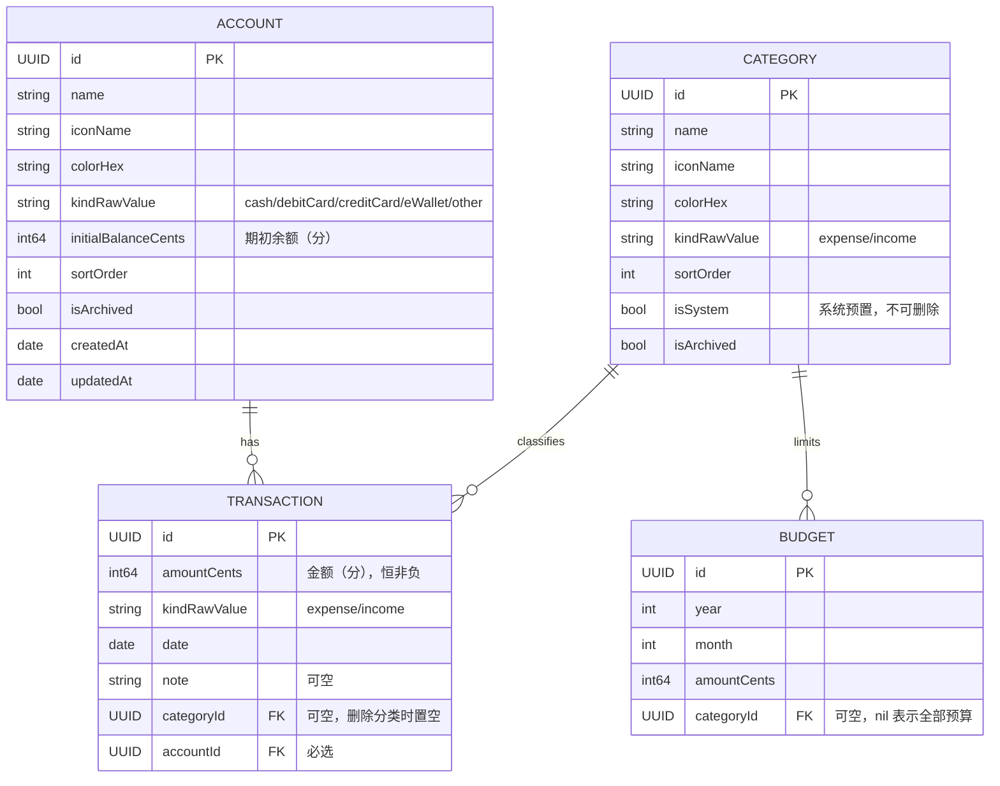

# Spendge 架构设计

## 数据模型

关系规则：

| 关系 | 删除规则 | 说明 |
| --- | --- | --- |
| Account → Transaction | cascade | 服务层会先拦截：有账单的账户不允许删除 |
| Category → Transaction | nullify | 删除分类保留账单，账单分类置空；系统分类禁止删除 |
| Category → Budget | cascade | 删除分类同时删除其预算 |

## 核心设计决策

1. **金额一律存整数分（Int64）**，展示时经 `Money` 工具转 `Decimal`，避免浮点误差。
2. **枚举存 rawValue 字符串**（如 `kindRawValue`），便于 `#Predicate` 查询与后续数据迁移。
3. **时间存完整 `Date`**，月度聚合用 `Calendar.current` 按本地时区切分，不做字符串日期。
4. **账户必选**：每笔账单必须挂在一个账户下，保证余额可精确追溯。
5. **分类软删除**（`isArchived`），历史账单与统计不受影响。
6. **服务层 `@MainActor` + `ModelContext`**：UI 层直接调用服务方法，未来如需后台写入再引入 actor。
7. **不做独立账号**：不注册、不要手机号邮箱；同步身份直接用 iCloud，未登录也能完整使用。设置页展示的是 iCloud 状态，不是登录表单。
8. **品牌素材与开屏**：logo 原图与去水印版在 `design/logo/`。开屏由系统启动屏承载：`spendge/Info.plist` 的 `UILaunchScreen` 指定 `LaunchBackground` 色板（`#E9F1F4`，避免白底）与 `LaunchLogo` 图片（logo-2 泛洪去背景，230pt 宽，1x/2x/3x 三档）。App 首帧与启动屏同位置的 logo 做 0.4 秒交叉淡出、界面同时淡入，**不加任何延迟**。改启动屏资源后模拟器需重启才能刷新快照缓存。`spendge/Info.plist` 是唯一的 Info.plist 来源（`GENERATE_INFOPLIST_FILE = NO`）：显示名、权限文案、屏幕方向、场景清单、启动屏都写在文件里，不再用 `INFOPLIST_KEY_*` 构建设置。
9. **字阶只有一套**（Typography.swift）：hero / pageTitle / sectionTitle / number / numberSmall / numberLarge / amountInput / rowTitle / body / bodyStrong / label / caption / captionStrong / axisLabel。重量只用 regular 与 semibold，rounded 只给标题和数字；视图里不再手写 .font(.system(size:))，只有金额输入的动态字号例外。
10. **只做中文**（2026-11-14）：不做多语言，没有 String Catalog，文案直接写中文；日期统一用 zh_CN，避免英文系统下出现英文日期名。
12. **目标（Goal）**：独立表，暂不与 Budget 合并。历史不落表，按参数逐周期回算（`GoalService.history`），避免双份真相。只做四种封闭类型（zeroSpendDays / countLimit / categorySum / netInflow），每种类型在 `GoalService` 里只负责三件事：聚合、单位、方向；加类型靠改代码，用户能自定义的只有范围和阈值。
13. **间距只有三级**：`PageLayout` 提供 `pageInset`（24）、`sectionGap`（32）、`blockGap`（12）、`inlineGap`（8）。页面容器只加一次，组件内部不再手填数字微调——之前图例多缩进 18、区块间距 26/30/48 各写一套，就是这样散出来的。
11. **颜色只认语义 token**（2026-11-21 收口）：视图用 `Color.brand / brandSoft / income / warning / danger / info / onAccent / scrim / canvas / surface / surfaceElevated / textPrimary / textSecondary`，不直接写 hex、`.red`、`.white` 或系统灰。`info` 是冷蓝，收入金额与刚性 / 稳定结构共用；`onAccent` 是强调色上的文字与图标；`scrim` 是浮层遮罩。
    - 换主题只改 `Palette.current`；`Palette.warm` 已按奶油桃配色备好但未启用。注意 `current` 是静态值，真正做切换时要改成环境注入才能触发刷新。
    - 饼图 / 图例的领域色集中在 `Palette.domainColors`，通过 `Color.domainColor(_:)` 取；它们是主题的一部分，但允许临时微调。
    - 分类自身的颜色（`Category.colorHex`）是**数据**，存在库里，不属于主题 token。

## 离线优先与鲁棒性（服务可退场）

> 服务端随时可能不可用（事故或主动关停），客户端以「本地可用」为最高优先级。服务端契约与退场流程见 server-design §12，这里是客户端落地要求。

### 原则
- 本地是唯一事实源：记账、浏览、统计、预算、iCloud 同步全部不依赖自有服务端。
- 记账主流程不得出现「必须联网」或「必须登录」；任何服务端失败都不得阻塞记录。
- 服务端只做增强（解析、账号、权益校验），失败即降级，不弹阻断式错误。

### 依赖与降级（客户端视角）

| 能力 | 服务端不可用时客户端行为 |
|---|---|
| 本地记账 / 浏览 / 统计 / 预算 | 正常，不受影响 |
| iCloud 同步（CloudKit） | 正常，与自有服务端无关 |
| 匿名账号 / token | 不新建；已有 token 过期按游客态 |
| 云端解析 | 降级本地规则 / 手动录入，提示「暂用本地识别」 |
| 业务事件上报 | 静默失败，进本地队列，恢复后重放 |

### 网络层
- 所有请求异步，连接/读取均设超时；失败按指数退避 + 抖动重试，仅对幂等请求重试。
- 解析与写请求带 clientRequestId 做幂等，重试不重复扣额度。
- 熔断：连续失败进入离线态，冷却后半开探测，避免每次操作都卡在超时。
- 统一错误映射：401 → 游客态；429 → 限流提示 + retryAfter；5xx / 超时 → 降级，不阻塞。

### 状态与恢复
- 显式状态机：在线 / 弱网 / 离线 / 降级 / 恢复；由网络可达性监听 + 服务健康探测驱动。
- 离线期间的操作进持久化队列（重启不丢），恢复后按序幂等重放。
- 恢复后校正本地权益缓存与服务端差异；冲突时不损害已购权益（宁可放行）。

### 缓存
- 权益（entitlements，含 expires_at）本地缓存，冷启动即可判权，无需先联网。
- 账号与 token 存 Keychain；token 过期或校验失败降级游客态，不阻断本地。
- 解析草稿本地暂存，用户确认后再落库，避免网络中断丢输入。

### 版本与兼容
- 服务端 API 版本化（/v1）；客户端忽略未知字段，服务下线或变更时不得崩溃。
- 灰度与最小支持版本：老版本客户端在服务退场时仍需保留可用的纯本地路径。

### 验收（客户端）
- [ ] 飞行模式 / 断网：记账、浏览、统计、预算全部可用
- [ ] 服务端 5xx / 超时：解析降级，无阻断弹窗
- [ ] 弱网抖动：重试不重复扣额度
- [ ] 冷启动无网络：权益与账号从本地缓存恢复
- [ ] 服务恢复：自动补同步、幂等、不重复
- [ ] 服务端彻底下线：App 纯本地模式运行，无需更新

## 导航层级（2026-11-23）

- **四个 tab 常驻**：记账 / 统计 / 目标 / 设置。底部导航在任何二级页都保留。
- **二级页统一容器**：`SecondaryPage` 负责背景、返回、顶部/底部留白与右滑返回；滚动内容用默认模式，记一笔传 `scrollable: false`，页面只写内容。
- **二级页挂在所属 tab 的内容区**：记一笔 / 编辑、分类明细、奖杯墙、开发者页。
  - 从右滑入，左上角返回，支持右滑返回；
  - 记录页不可滚动，返回固定在顶部；其余页面的返回按钮随内容滚动。
- **切 tab 即回根页**：二级页不跨 tab 保留；切 tab 时关闭全部二级页，隐藏状态与待弹庆祝一并清掉。
- 例外：解锁庆祝是瞬间的全屏覆盖，仍然盖住底部导航，结束即消失。

## 功能流程

### 记一笔

1. 用户输入金额，选择收支类型 / 分类 / 账户 / 日期 / 备注。
2. `TransactionService.add(...)` 校验金额 > 0 后落库。
3. 余额、月度汇总、预算进度均为查询时实时计算，无需额外维护。

### 流水浏览

- 按月：`transactions(from:to:)`（半开区间 `[start, end)`，按时间倒序）
- 按账户 / 分类 / 备注关键词过滤

### 月度统计

- `summary(forMonth:)` → 支出/收入总额、净收支、分类分布（`CategorySummary` 快照，面向 UI）

### 预算

- `setBudget(category:amountCents:year:month:)` 幂等 upsert（同月同分类更新金额）
- `spentCents(category:year:month:)` 统计当月对应范围支出
- `progress(for:)` → 已支出 / 预算 / 剩余 / 比例

### 设置

- 三个页面横向分页：**设置（0）· 今天（1）· 回看（2）**；启动停在今天，首页右滑进设置、左滑进回看。
- 设置页目前只是壳：同步 / 记录偏好 / 数据 / 关于四组入口，开关与跳转都未接实现。
- 不建独立账号体系：身份即 iCloud 账号，未登录也能完整使用（详见 dev-plan M4-1）。

### 账户管理

- 增、改、归档；**存在账单的账户禁止删除**
- `balanceCents(for:)` = 期初余额 + 收入 − 支出
- `totalAssetsCents()` 汇总全部账户（含已归档）

## 已知坑（开发期踩过）

1. **不要同时存在两个指向同一组 Model 的 ModelContainer。** 第二个（哪怕是 in-memory）在第一次 fetch 时会 EXC_BREAKPOINT。需要隔离环境时用独立进程，或直接读主容器。
2. **#Predicate 里不能访问枚举的 rawValue。** 运行时 trap，不会抛错。必须在外层先取出字符串：`let raw = kind.rawValue`，再写 `#Predicate { $0.kindRawValue == raw }`。
3. **结构变更不做迁移，只留兜底。** 先尝试就地迁移，失败才在 DEBUG 下删 store 重来；不能按版本号无条件删库——覆盖安装会丢用户数据。
4. **整页呈现用转场 + `geometryGroup()`，不要手工改 `offset` 做滑入。**「先设 flag 再 `withAnimation` 改 offset」在同一个 runloop 里完成时，新插入的页面没有旧值可插值，整页直接弹出。换 `.transition(.move(edge: .trailing))` 之后还有一层坑：转场期间内部布局会重新求解，`.ignoresSafeArea()` 的底色和内容会各走各的、内容还会溢到页面外——现象就是「日期轴先出现在上一页上」。加 `.geometryGroup()` 冻结转场期间的布局，整页才作为一个图层滑入。另外别在子视图上加 `.transaction { $0.animation = nil }`，那会让该子视图直接跳到终点位置。

## 后续扩展位

- 转账：`Transaction.toAccount` 字段方向已预留
- 周期记账 / 重复账单
- CloudKit 同步与备份
- 数据导出（CSV / 文本）
- 分类明细的「全部日期」：明细页目前只列统计页当前选中的期间；后续加日期范围切换，跨期间列出该分类的全部记录，标题与合计改成「全部时间」。
