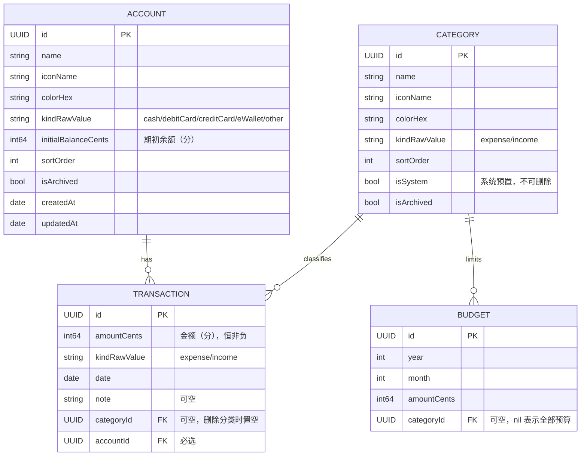

# Spendge 架构设计

## 数据模型

关系规则：

| 关系 | 删除规则 | 说明 |
| --- | --- | --- |
| Account → Transaction | cascade | 服务层会先拦截：有账单的账户不允许删除 |
| Category → Transaction | nullify | 删除分类保留账单，账单分类置空；系统分类禁止删除 |
| Category → Budget | cascade | 删除分类同时删除其预算 |

## 核心设计决策

1. **金额一律存整数分（Int64）**，展示时经 `Money` 工具转 `Decimal`，避免浮点误差。
2. **枚举存 rawValue 字符串**（如 `kindRawValue`），便于 `#Predicate` 查询与后续数据迁移。
3. **时间存完整 `Date`**，月度聚合用 `Calendar.current` 按本地时区切分，不做字符串日期。
4. **账户必选**：每笔账单必须挂在一个账户下，保证余额可精确追溯。
5. **分类软删除**（`isArchived`），历史账单与统计不受影响。
6. **服务层 `@MainActor` + `ModelContext`**：UI 层直接调用服务方法，未来如需后台写入再引入 actor。

## 功能流程

### 记一笔

1. 用户输入金额，选择收支类型 / 分类 / 账户 / 日期 / 备注。
2. `TransactionService.add(...)` 校验金额 > 0 后落库。
3. 余额、月度汇总、预算进度均为查询时实时计算，无需额外维护。

### 流水浏览

- 按月：`transactions(from:to:)`（半开区间 `[start, end)`，按时间倒序）
- 按账户 / 分类 / 备注关键词过滤

### 月度统计

- `summary(forMonth:)` → 支出/收入总额、净收支、分类分布（`CategorySummary` 快照，面向 UI）

### 预算

- `setBudget(category:amountCents:year:month:)` 幂等 upsert（同月同分类更新金额）
- `spentCents(category:year:month:)` 统计当月对应范围支出
- `progress(for:)` → 已支出 / 预算 / 剩余 / 比例

### 账户管理

- 增、改、归档；**存在账单的账户禁止删除**
- `balanceCents(for:)` = 期初余额 + 收入 − 支出
- `totalAssetsCents()` 汇总全部账户（含已归档）

## 已知坑（开发期踩过）

1. **不要同时存在两个指向同一组 Model 的 ModelContainer。** 第二个（哪怕是 in-memory）在第一次 fetch 时会 EXC_BREAKPOINT。需要隔离环境时用独立进程，或直接读主容器。
2. **#Predicate 里不能访问枚举的 rawValue。** 运行时 trap，不会抛错。必须在外层先取出字符串：`let raw = kind.rawValue`，再写 `#Predicate { $0.kindRawValue == raw }`。
3. **结构变更不做迁移，只留兜底。** 先尝试就地迁移，失败才在 DEBUG 下删 store 重来；不能按版本号无条件删库——覆盖安装会丢用户数据。
4. **整页呈现用转场 + `geometryGroup()`，不要手工改 `offset` 做滑入。**「先设 flag 再 `withAnimation` 改 offset」在同一个 runloop 里完成时，新插入的页面没有旧值可插值，整页直接弹出。换 `.transition(.move(edge: .trailing))` 之后还有一层坑：转场期间内部布局会重新求解，`.ignoresSafeArea()` 的底色和内容会各走各的、内容还会溢到页面外——现象就是「日期轴先出现在上一页上」。加 `.geometryGroup()` 冻结转场期间的布局，整页才作为一个图层滑入。另外别在子视图上加 `.transaction { $0.animation = nil }`，那会让该子视图直接跳到终点位置。

## 后续扩展位

- 转账：`Transaction.toAccount` 字段方向已预留
- 周期记账 / 重复账单
- CloudKit 同步与备份
- 数据导出（CSV / 文本）
