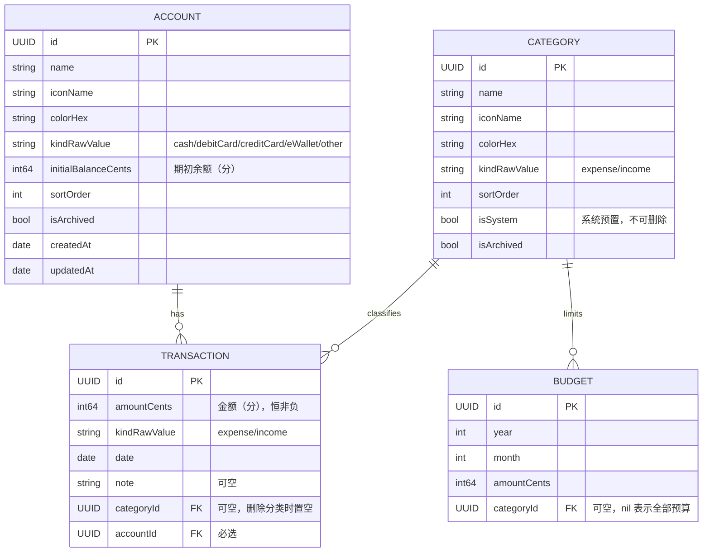

# Spendge 架构设计

## 数据模型

关系规则：

| 关系 | 删除规则 | 说明 |
| --- | --- | --- |
| Account → Transaction | cascade | 服务层会先拦截：有账单的账户不允许删除 |
| Category → Transaction | nullify | 删除分类保留账单，账单分类置空；系统分类禁止删除 |
| Category → Budget | cascade | 删除分类同时删除其预算 |

## 核心设计决策

1. **金额一律存整数分（Int64）**，展示时经 `Money` 工具转 `Decimal`，避免浮点误差。
2. **枚举存 rawValue 字符串**（如 `kindRawValue`），便于 `#Predicate` 查询与后续数据迁移。
3. **时间存完整 `Date`**，月度聚合用 `Calendar.current` 按本地时区切分，不做字符串日期。
4. **账户必选**：每笔账单必须挂在一个账户下，保证余额可精确追溯。
5. **分类软删除**（`isArchived`），历史账单与统计不受影响。
6. **服务层 `@MainActor` + `ModelContext`**：UI 层直接调用服务方法，未来如需后台写入再引入 actor。
7. **不做独立账号**：不注册、不要手机号邮箱；同步身份直接用 iCloud，未登录也能完整使用。设置页展示的是 iCloud 状态，不是登录表单。
8. **品牌素材与开屏**：logo 原图与去水印版在 `design/logo/`。开屏由系统启动屏承载：`Config/Info.plist` 的 `UILaunchScreen` 指定 `LaunchBackground` 色板（`#E9F1F4`，避免白底）与 `LaunchLogo` 图片（logo-2 泛洪去背景，230pt 宽，1x/2x/3x 三档）。App 首帧与启动屏同位置的 logo 做 0.4 秒交叉淡出、界面同时淡入，**不加任何延迟**。改启动屏资源后模拟器需重启才能刷新快照缓存。
9. **语言切换**：设置页写 `UserDefaults` 的 `AppleLanguages`，重启后整包生效——`String(localized:)` 读的是 Bundle 语言，运行时切换只能靠重启。插值文案一律走语义键 + `String(format:)`，不要依赖编译器生成的格式串。
10. **分类改名的语言约定**：分类名存在数据库里，系统分类按中文名查表得到译文，用户改过名的直接显示原名。**在英文环境下改名只允许输入英文**，否则中英混排的条目无法被翻译，切回中文时也会显得脏。
11. **文案只认 String Catalog**：`Localizable.xcstrings` 源语言 zh-Hans，英文是译文；App 名称走 `InfoPlist.xcstrings`。`Text("字面量")` 自动本地化，作为 `String` 拼出来的文案（洞察句、提示、弹窗）要用 `String(localized:)` 或 `Text(LocalizedStringKey(_:))`，否则永远是中文。日期与数字不要写死 locale。
12. **间距只有三级**：`PageLayout` 提供 `pageInset`（24）、`sectionGap`（32）、`blockGap`（12）、`inlineGap`（8）。页面容器只加一次，组件内部不再手填数字微调——之前图例多缩进 18、区块间距 26/30/48 各写一套，就是这样散出来的。
9. **颜色只认语义 token**：视图用 `Color.brand / surface / surfaceElevated / canvas / income` 与 `Palette.current.domainColor(_:)`，不直接写 hex 或系统灰。换主题只改 `Palette.current`；`Palette.warm` 已按奶油桃配色备好但未启用。注意 `current` 是静态值，真正做切换时要改成环境注入才能触发刷新。

## 功能流程

### 记一笔

1. 用户输入金额，选择收支类型 / 分类 / 账户 / 日期 / 备注。
2. `TransactionService.add(...)` 校验金额 > 0 后落库。
3. 余额、月度汇总、预算进度均为查询时实时计算，无需额外维护。

### 流水浏览

- 按月：`transactions(from:to:)`（半开区间 `[start, end)`，按时间倒序）
- 按账户 / 分类 / 备注关键词过滤

### 月度统计

- `summary(forMonth:)` → 支出/收入总额、净收支、分类分布（`CategorySummary` 快照，面向 UI）

### 预算

- `setBudget(category:amountCents:year:month:)` 幂等 upsert（同月同分类更新金额）
- `spentCents(category:year:month:)` 统计当月对应范围支出
- `progress(for:)` → 已支出 / 预算 / 剩余 / 比例

### 设置

- 三个页面横向分页：**设置（0）· 今天（1）· 回看（2）**；启动停在今天，首页右滑进设置、左滑进回看。
- 设置页目前只是壳：同步 / 记录偏好 / 数据 / 关于四组入口，开关与跳转都未接实现。
- 不建独立账号体系：身份即 iCloud 账号，未登录也能完整使用（详见 dev-plan M4-1）。

### 账户管理

- 增、改、归档；**存在账单的账户禁止删除**
- `balanceCents(for:)` = 期初余额 + 收入 − 支出
- `totalAssetsCents()` 汇总全部账户（含已归档）

## 已知坑（开发期踩过）

1. **不要同时存在两个指向同一组 Model 的 ModelContainer。** 第二个（哪怕是 in-memory）在第一次 fetch 时会 EXC_BREAKPOINT。需要隔离环境时用独立进程，或直接读主容器。
2. **#Predicate 里不能访问枚举的 rawValue。** 运行时 trap，不会抛错。必须在外层先取出字符串：`let raw = kind.rawValue`，再写 `#Predicate { $0.kindRawValue == raw }`。
3. **结构变更不做迁移，只留兜底。** 先尝试就地迁移，失败才在 DEBUG 下删 store 重来；不能按版本号无条件删库——覆盖安装会丢用户数据。
4. **整页呈现用转场 + `geometryGroup()`，不要手工改 `offset` 做滑入。**「先设 flag 再 `withAnimation` 改 offset」在同一个 runloop 里完成时，新插入的页面没有旧值可插值，整页直接弹出。换 `.transition(.move(edge: .trailing))` 之后还有一层坑：转场期间内部布局会重新求解，`.ignoresSafeArea()` 的底色和内容会各走各的、内容还会溢到页面外——现象就是「日期轴先出现在上一页上」。加 `.geometryGroup()` 冻结转场期间的布局，整页才作为一个图层滑入。另外别在子视图上加 `.transaction { $0.animation = nil }`，那会让该子视图直接跳到终点位置。

## 后续扩展位

- 转账：`Transaction.toAccount` 字段方向已预留
- 周期记账 / 重复账单
- CloudKit 同步与备份
- 数据导出（CSV / 文本）
